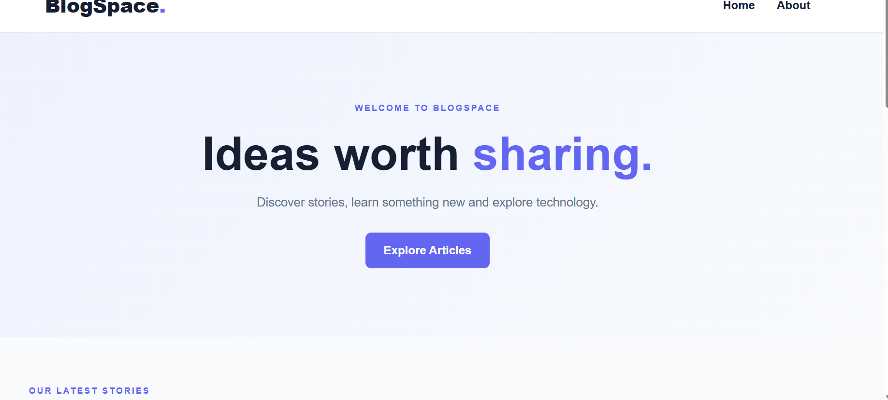
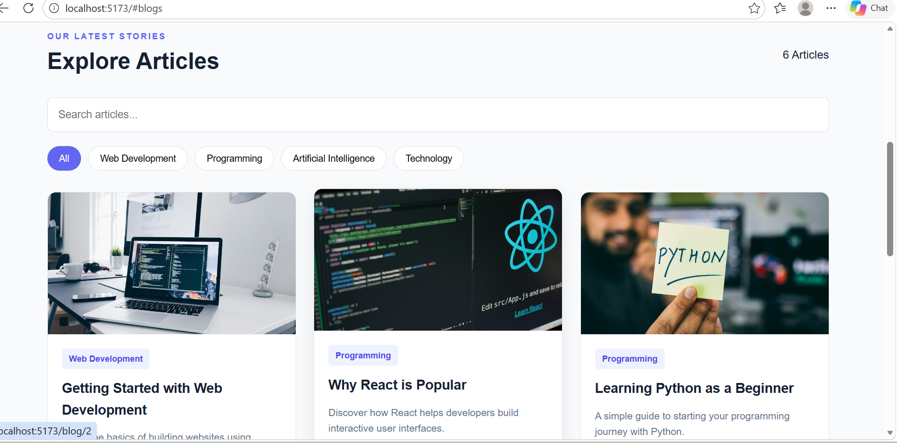
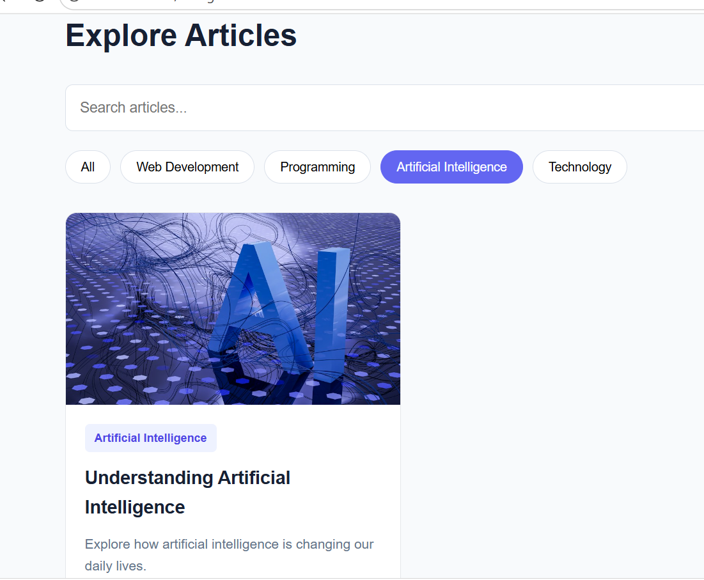
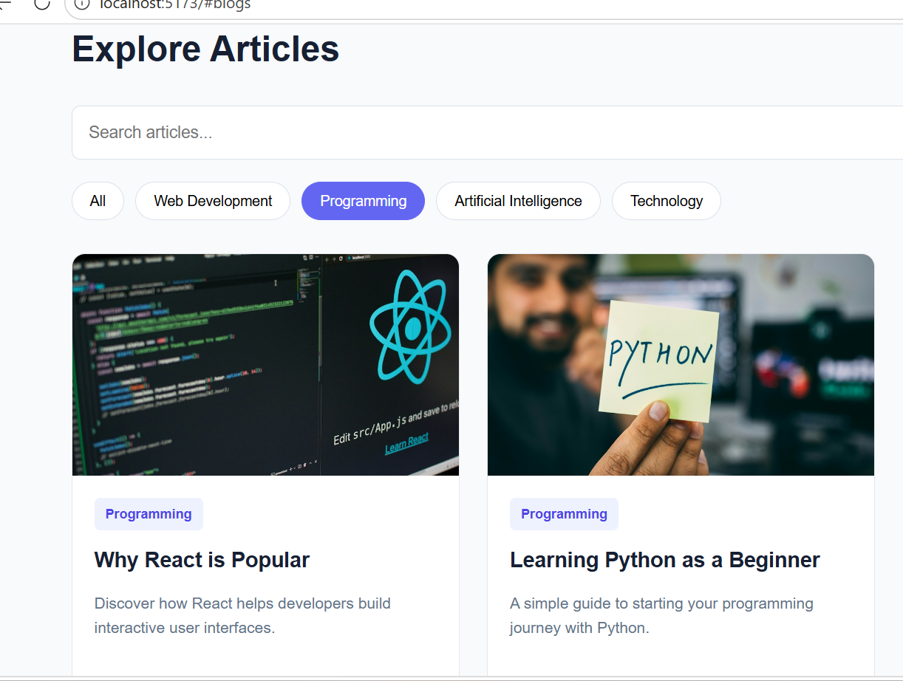
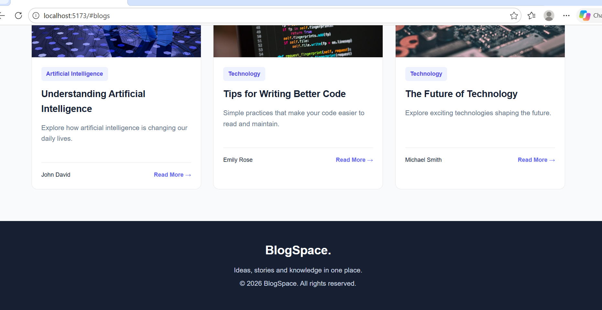
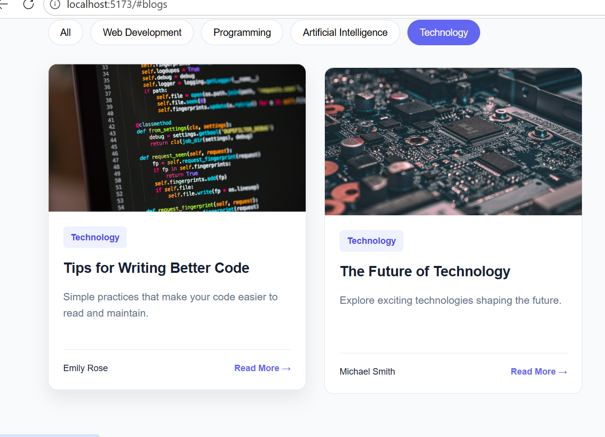
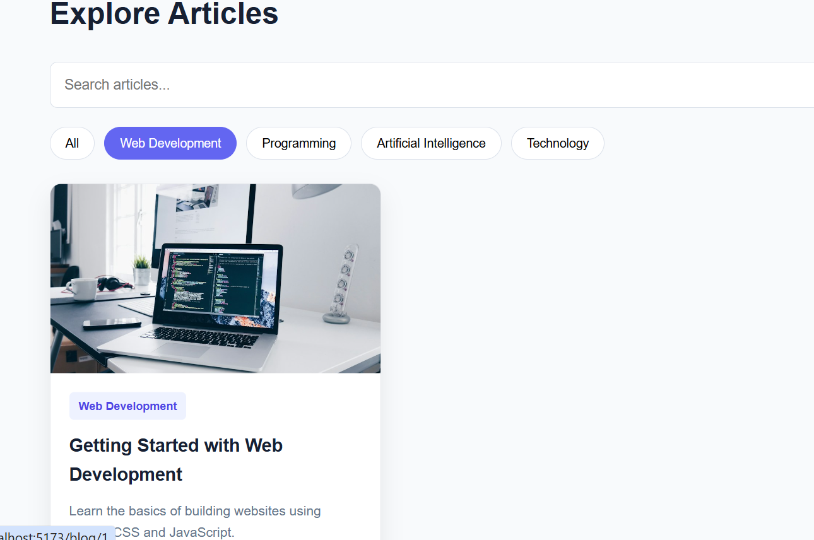

🌐 BlogSpace – Responsive Blog UI

A modern, responsive blog website built using React.js, designed to help users explore articles, search for content, filter posts by category, and read individual blog articles.

---

📌 1. Project Overview

BlogSpace is a frontend web development project created as part of the SDM Technology Internship – Week 4 Mini Project.

The application displays blog articles using mock JSON data. Users can browse articles, search by title or description, filter posts by category, and navigate to individual article detail pages.

The project focuses on React components, API data fetching, routing, responsive design, and user-friendly interfaces.

🎯 2. Project Objectives

- Build a responsive blog user interface.
- Create blog listing and detail pages.
- Display data from a local JSON file.
- Implement search functionality.
- Add category-based filtering.
- Handle loading and error states.
- Provide smooth navigation between pages.
- Create a user-friendly experience on different screen sizes.

✨ 3. Features

🏠 Homepage

- Modern and attractive homepage.
- Navigation bar and introduction section.
- Explore Articles button.

📰 Blog Listing

- Displays six sample blog articles.
- Article images, titles, descriptions, categories and authors.
- Card-based layout.

🔍 Search Functionality

- Search articles by title.
- Search articles by description.
- Display matching search results.

🗂️ Category Filtering

Filter articles using these categories:

- Web Development
- Programming
- Artificial Intelligence
- Technology

📖 Blog Detail Page

- Individual page for each article.
- Article title and image.
- Author and publication date.
- Complete article content.
- Back to Articles navigation.

⚡ Loading and Error Handling

- Loading message while fetching data.
- Error message if data fetching fails.
- Empty results message when no articles match.

📱 Responsive Design

- Desktop-friendly layout.
- Tablet-friendly layout.
- Mobile-friendly layout.

🔗 Navigation

- React Router DOM.
- Dynamic blog detail routes.
- Page Not Found handling.

---

🛠️ 4. Technologies Used

Technology| Purpose
React.js| Building the user interface
JavaScript| Application functionality
HTML5| Website structure
CSS3| Styling and responsive design
React Router DOM| Page navigation
Fetch API| Fetching JSON data
JSON| Mock blog data
Vite| Development environment

---

📸 5. Project Output Screenshots

## 📸 Project Screenshots

### 1. Homepage

### 2. Blog Listing

### 3. AI Category

### 4. Programming Category

### 5. Responsive Design

### 6. Technology Category

### 7. Web Development Category

---

📁 6. Project Folder Structure

blog-ui/
│
├── public/
│   └── blogs.json
│
├── screenshots/
│   ├── homepage.png
│   ├── blog-list.png
│   ├── AI.png
│   ├── Programming.png
│   ├── responsive-design.png
│   ├── Technology.png
│   └── webdevelopment.png
│
├── src/
│   ├── App.jsx
│   ├── index.css
│   └── main.jsx
│
├── index.html
├── package.json
├── package-lock.json
└── README.md

---

🚀 7. Installation and Setup

Follow these steps to run BlogSpace on your computer.

Step 1: Clone the Repository

git clone YOUR_GITHUB_REPOSITORY_URL

Step 2: Open the Project Folder

cd blog-ui

Step 3: Install Dependencies

npm install

Step 4: Start the Development Server

npm run dev

Step 5: Open the Website

Open the local URL displayed in your terminal.

Usually:

http://localhost:5173/

---

🧪 8. Testing

The following functionalities should be tested:

- Verify that all six blog articles are displayed.
- Search articles using keywords.
- Filter articles using category buttons.
- Open individual blog detail pages.
- Navigate back to the homepage.
- Check loading and error messages.
- Test an invalid blog URL.
- Check the layout on desktop and mobile screens.

---

📚 9. What I Learned

Through this project, I gained practical experience in frontend development using React.js.

I learned how to:

- Create reusable React components.
- Fetch and display JSON data using the Fetch API.
- Implement search and category filtering.
- Navigate between pages using React Router DOM.
- Create individual blog detail pages.
- Handle loading, error and empty states.
- Design responsive layouts using CSS.

This project improved my understanding of React and helped me develop practical web development skills.

---

👩‍💻 10. About the Developer

Khairunnisa Ladkhan Athani

Computer Science and Engineering Student

Interested in Software Development, Web Development and Artificial Intelligence.

GitHub: https://github.com/Khairunnisaathani

LinkedIn: https://www.linkedin.com/in/khairunnisa-athani-963186444/

---

🎓 11. Internship Project

Organization: SDM Technology

Program: Technology Internship

Task: Week 4 – Mini Project

Project Title: Blog UI

---

⭐ Acknowledgement

This project was developed as part of my SDM Technology Internship. It provided an opportunity to practise React.js, frontend development, JSON data handling, routing and responsive web design.

Thank you for visiting BlogSpace!

---
